<div align="center">

# LinkedBuddy

**Turn the work you already did on GitHub into LinkedIn posts you'd actually publish.**


</div>

LinkedBuddy watches your GitHub repositories, picks out the work worth talking about, and drafts LinkedIn posts that stick to what is actually in your commits. Each draft comes with an architecture diagram. You review, edit and publish. **Nothing gets posted without you.**

It's a self-hosted tool for one owner, and it runs entirely on free tiers: Supabase Postgres and the Gemini API.

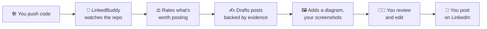

---

## Table of contents

- [Why it exists](#why-it-exists)
- [Who it's for and what it isn't](#who-its-for-and-what-it-isnt)
- [Features](#features)
- [How it works](#how-it-works)
  - [System architecture](#system-architecture)
  - [The end-to-end pipeline](#the-end-to-end-pipeline)
  - [Stage 1: ingestion and classification](#stage-1-ingestion-and-classification)
  - [Stage 2: triage and rating](#stage-2-triage-and-rating)
  - [Stage 3: context building and the privacy guard](#stage-3-context-building-and-the-privacy-guard)
  - [Stage 4: draft generation](#stage-4-draft-generation)
  - [Stage 5: review, media and publishing](#stage-5-review-media-and-publishing)
  - [The job queue](#the-job-queue)
  - [Data model](#data-model)
  - [Security model](#security-model)
  - [Performance design](#performance-design)
- [Tech stack](#tech-stack)
- [Getting started](#getting-started)
- [Configuration reference](#configuration-reference)
- [API reference](#api-reference)
- [Development and testing](#development-and-testing)
- [Project layout](#project-layout)
- [Troubleshooting](#troubleshooting)
- [Deploying beyond localhost](#deploying-beyond-localhost)
- [Roadmap](#roadmap)

---

## Why it exists

Developers ship interesting work every week, and almost none of it reaches LinkedIn, where recruiters, collaborators and peers actually look. GitHub is the log. LinkedIn is the signal. The log is full and the signal is silent.

Skill isn't the barrier. Switching from building to writing is:

| Pain | What LinkedBuddy does about it |
|---|---|
| **The blank page.** Turning a diff into a story is real writing work. | Drafts 2–3 variants from your actual commits, README and releases. |
| **"Is this big enough to post?"** | Rates every event `high` / `medium` / `low` with a one-line reason. |
| **The visuals gap.** A diagram takes an hour in a design tool. | Generates an editable Mermaid diagram with every draft. |
| **Voice mismatch.** AI drafts sound like marketing copy. | A tone dial, your own past posts as voice samples, a ban list, and an anti-slop linter. |
| **Repeating yourself.** | Feeds your last post about the repo to the model with an instruction not to repeat it. |
| **The AI-slop penalty.** LinkedIn demotes generic, automated content. | Every claim cites evidence, and there is no auto-posting, ever. |

## Who it's for and what it isn't

**For:** developers, students and researchers who build in public on GitHub and want their LinkedIn to reflect that work without spending an evening on each post.

**It deliberately is not:**

| Not | Why |
|---|---|
| An auto-poster | Reviewing before posting is the whole point, and it matches where LinkedIn is heading. |
| A multi-platform content blaster | It's built for LinkedIn and professional signal first. |
| A generic AI writer | The input is always real repository evidence. No evidence, no draft. |
| A growth-hack engine | Engagement pods and comment automation are exactly what LinkedIn penalises. |

---

## Features

### 📥 Triage inbox
- **Scheduled polling** with conditional (ETag) requests. An unchanged repo costs zero GitHub rate limit.
- **Commit classification** into `feature`, `fix`, `code`, `docs`, `dependency`, `merge` and `noise`. Lockfiles, build output and minified bundles are ignored, and notebook lines count at a tenth of their weight.
- **Commits grouped into events:** new repo, release, merged PR, push group, labeled, or manual.
- **Two-stage rating:** a free heuristic gate first, then a cheap LLM judge, only for events that pass the gate.
- **Per-repo modes:** `always_suggest`, `releases_and_large`, `manual_only`, `muted`.
- **Manual events** for any commit range you want to post about, whatever its score.

### ✍️ Drafts grounded in evidence
- **2–3 variants per event**, each from a different angle, with up to 3 alternate openings and an optional first comment.
- **Every sentence cites evidence**, for example `readme:L14`, `commit:a1b2c3d` or `release:v2.0`. Citations that don't match the context are flagged **unsupported** in the UI.
- **Voice controls:** tone preset, length, emoji policy, hashtag count (0–5), custom instructions, up to 5 voice samples, and a ban list.
- **Anti-slop linter:** banned phrases, a buzzword count, a specificity score, and LinkedIn's 3,000-character limit.
- **Regenerate** with a different tone, or **quick-edit** with a preset ("make it shorter", "more casual", "fewer buzzwords") or your own instruction.

### 🖼️ Media tray
- **Generated Mermaid diagrams**, rendered to PNG in a sandboxed headless Chromium. You can edit the source and re-render.
- **Screenshot uploads**, decoded and verified, re-encoded, and stripped of EXIF data.
- **Optional video:** Gemini writes a scene script and the `brag` renderer turns it into an MP4. Opt-in only.

### 📤 Review and publish
- A LinkedIn-style preview, one-click copy for the draft and the first comment, and approve / discard.
- **Recording a post** saves the final text and the commit range it covered, so later drafts know what you've already said.
- **An archive** of published posts, with metrics you can log by hand (impressions, reactions and so on). It doubles as the calibration dataset.

### 🔒 Privacy and security
- Private repos are **never sent to Gemini by default**.
- Four privacy modes, enforced in code rather than in the prompt.
- Secrets are redacted before every LLM call.
- Prompt-injection hardening: repo text is treated as untrusted data, the model gets no tools, and output must match a JSON schema.
- One owner password (argon2id), server-side sessions, a CSRF header, a strict CORS allowlist, an outbound-host allowlist, and tokens encrypted at rest.

---

## How it works

### System architecture

The backend is **one Python package that runs as four processes**. They never call each other directly: they communicate only through Postgres rows and `LISTEN`/`NOTIFY`. There is no Redis, no Celery, no Docker and no message broker.

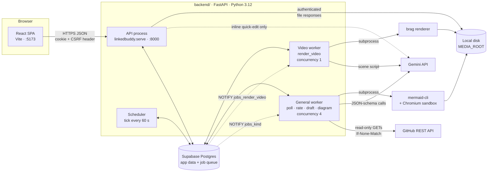

| Process | Command | Job kinds | Why it's separate |
|---|---|---|---|
| **API** | `python -m linkedbuddy.serve` | none | HTTP only. Never renders anything or calls Gemini in bulk, so the UI stays responsive. |
| **Worker** | `python -m linkedbuddy.worker` | `poll_repo`, `rate_event`, `generate_draft`, `render_diagram` | All slow external work happens here. |
| **Video worker** | `python -m linkedbuddy.worker --kinds render_video --concurrency 1` | `render_video` | A 10-minute render can never starve polls or drafts. |
| **Scheduler** | `python -m linkedbuddy.scheduler` | none (it enqueues them) | Starts polls, reclaims stale jobs, unsticks events, purges expired data. |

`backend/scripts/dev.sh` starts all four and stops all of them when you press Ctrl-C or when any one of them exits.

### The end-to-end pipeline

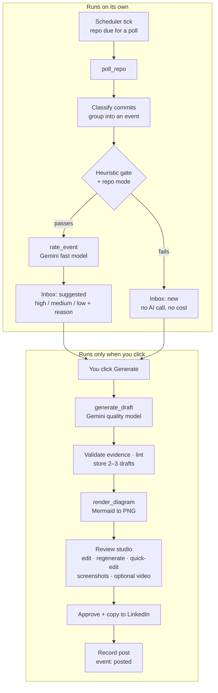

> **The cost rule:** Gemini is called for an event only if the event passed the free heuristic gate (for rating) or you clicked something (drafts, quick edits, video). No other code path calls the model.

### Stage 1: ingestion and classification

Each `poll_repo` job fetches only what changed:

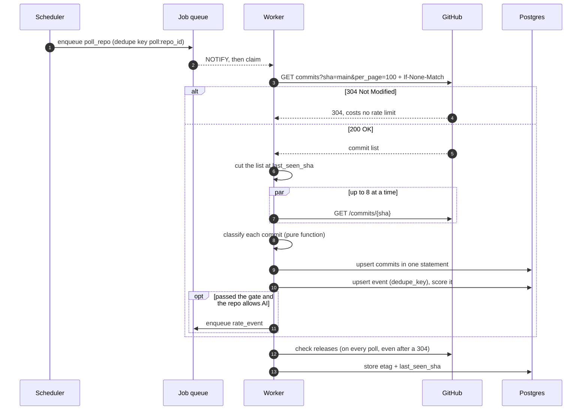

**Commit classification** is pure and rule-based, with no LLM involved:

| Kind | Rule |
|---|---|
| `merge` | More than one parent, or a message starting `Merge pull request` / `Merge branch` |
| `dependency` | Author ends in `[bot]`, or a message starting `Bump ` / `chore(deps)` |
| `noise` | No files left after ignoring lockfiles, `dist/`, `build/`, `node_modules/`, `.min.js` |
| `docs` | Every remaining file is `*.md` or under `docs/` |
| `feature` | Conventional commit `feat:` / `feat(scope):` |
| `fix` | Message starts with `fix` |
| `code` | Everything else |

**Edge cases handled:** force-pushes (`compare` returns 404, so the commits become a `push_group` with no base), empty repos (409 means no events), GitHub rate limits (the job pauses until `x-ratelimit-reset` and doesn't spend an attempt), and a cap of 100 commits per poll.

### Stage 2: triage and rating

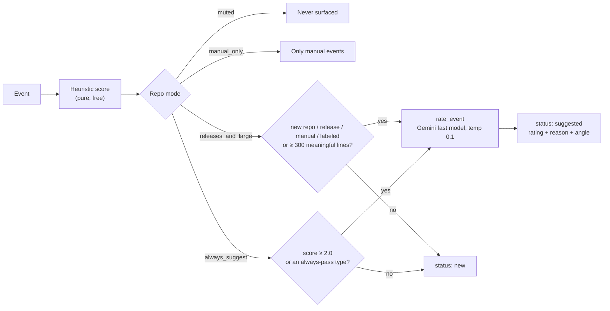

**Heuristic score** (`triage/score.py`):

| Signal | Points |
|---|---|
| Every commit is merge / dependency / noise / docs | the score is **0**, stop |
| New repository | +5 |
| Release | +4 |
| Labeled for posting | +5 |
| Has a `feat:` commit | +2 |
| New files | +1 each, up to +3 |
| README changed | +1 |
| Meaningful lines changed | +log₁₀(lines + 1), up to +3 |

**The LLM judge** writes one sentence of reasoning *first*, then scores six criteria from 1 to 5: **visible outcome, demonstrability, novelty, completeness, freshness, goal fit**. It is anchored to your stated goals from Settings. It returns `high`, `medium` or `low`, a suggested angle, and a list of assets you might want to add, such as a screenshot of the new UI.

### Stage 3: context building and the privacy guard

Before any model call, the event becomes a **context package**: a list of evidence entries, each with an ID the model must cite. This is also where privacy rules are enforced. They live in code, so a prompt can't override them.

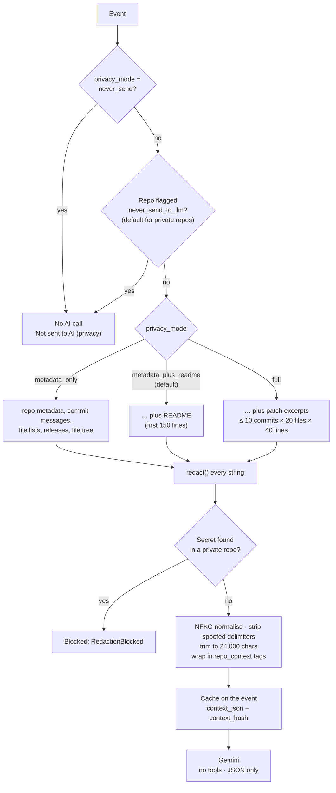

**Evidence IDs the model can cite:**

| ID | Source |
|---|---|
| `repo:meta` | Name, description, languages, topics, change stats |
| `readme:L42` | A single README line |
| `commit:a1b2c3d` | A commit message and its file list |
| `file:src/app.py` | A patch excerpt (only in `full` mode) |
| `release:v2.0.0` | Release notes |
| `prev_post` | Your last post about this repo, so the model doesn't repeat it |

**What redaction catches:** GitHub tokens (`ghp_`, `gho_`, `github_pat_` …), AWS keys (`AKIA…` / `ASIA…`), Google keys (`AIza…`), Slack tokens, JWTs, private key blocks, `.env`-style lines whose key contains `SECRET`, `TOKEN`, `PASSWORD` or `API_KEY`, and email addresses.

The package is cached, so **regenerations, tone switches and quick edits reuse it without calling GitHub again**. It's deleted 7 days after the event's newest draft.

### Stage 4: draft generation

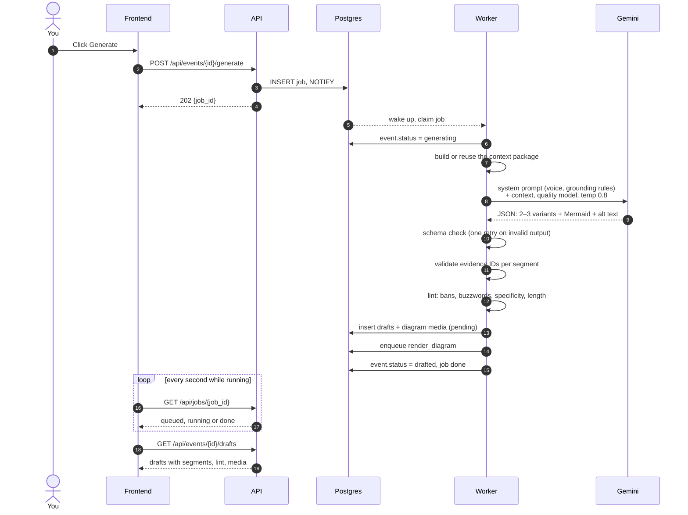

**What the model returns:**

```json
{
  "variants": [
    {
      "angle": "The 5x speedup from switching to keyset pagination",
      "segments": [
        { "text": "Our inbox query went from 900 ms to 180 ms.", "evidence": ["commit:a1b2c3d"] },
        { "text": "The fix was replacing OFFSET with keyset pagination in inbox/service.py.", "evidence": ["file:inbox/service.py"] }
      ],
      "alt_openings": ["OFFSET was quietly costing us 700 ms."],
      "first_comment": "Repo link: …"
    }
  ],
  "diagram_mermaid": "flowchart LR …",
  "alt_text_diagram": "Request flow from the inbox page to Postgres"
}
```

**How each draft is checked:**

| Check | What happens |
|---|---|
| Schema | Gemini is constrained with `response_schema`, then the output is re-validated with Pydantic. One retry, then the job fails visibly. |
| Evidence | Each segment has to cite at least one known ID. If it doesn't, it's marked `supported: false` and counted in `unsupported_claims`. |
| Banned phrases | A built-in list ("excited to announce", "game-changer", "thrilled", "delighted to share") merged with yours |
| Buzzwords | Counts words like *leverage, synergy, seamless, robust, unlock, empower, revolutionary …* |
| Specificity | Counts numbers, file names, `backticked code`, and words like *because*, *instead of*, *fixed*, *switched*, *tradeoff* |
| Length | Flags anything over 3,000 characters |
| Mermaid | Over 5,000 characters, or containing `click`, `href`, `<script` or `javascript:`, means it's rejected before rendering |

**Tone presets:**

| Tone | Style |
|---|---|
| Professional | Clear, measured, focused on outcomes, no slang |
| Casual | First person, conversational, short sentences, light humour |
| Technical | Leads with the problem or architecture, includes the stack and tradeoffs |
| Storytelling | Opens with the problem you hit, ends with what you learned |

Lengths: **short** is about 400–700 characters, **medium** about 800–1,400, and **long** about 1,500–2,500.

### Stage 5: review, media and publishing

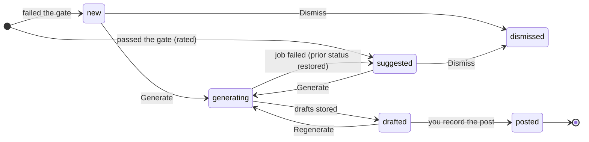

If a worker dies mid-generation, the scheduler notices that the event is stuck in `generating` with no live job and puts it back in the inbox, so an event never stays stuck.

Drafts have their own lifecycle: `draft`, then `approved` or `discarded`, and finally `posted`. **Publishing is guarded:** the API accepts it only for an `approved` draft, with the exact final text, at most 3,000 characters, and no leftover `[REDACTED` markers. For now, publishing means copying the text to LinkedIn and recording it. Nothing is ever sent to LinkedIn by the server.

**Frontend pages:**

| Page | What you do there |
|---|---|
| **Landing** (`/`) | The product overview |
| **Login** (`/login`) | Sign in with the owner password |
| **Inbox** (`/app/inbox`) | Browse rated events, filter, dismiss, generate |
| **Review** (`/app/review/:eventId`) | Compare variants, see evidence and lint results, edit, change tone, quick-edit, manage media, copy, approve, publish |
| **Archive** (`/app/archive`) | Your published posts, with the metrics you logged |
| **Settings** (`/app/settings`) | GitHub token, repo sync and modes, goals, tone, voice samples, ban list, privacy mode |

### The job queue

All background work goes through a Postgres table used as a queue.

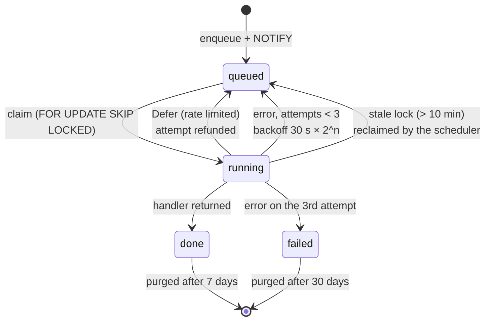

- **Claiming** is a single `UPDATE … WHERE id = (SELECT … FOR UPDATE SKIP LOCKED)`, so workers never block or double-claim each other.
- **Wake-up** uses `LISTEN jobs_<kind>`, with a 5-second polling fallback if the listen connection drops. Workers never busy-loop.
- **Dedupe keys** (a partial unique index on queued and running jobs) stop the same repo from being polled twice at once.
- **Gemini 429s** defer the job with exponential backoff from 10 s up to 10 min, without spending an attempt. Gemini 500, 503 and 504 errors also back off instead of failing.
- **Handlers are idempotent.** Re-running one never duplicates rows, thanks to upserts, dedupe keys and status checks.
- **Graceful shutdown:** on SIGTERM a worker stops claiming and gives in-flight jobs up to 30 s to finish.

**What the scheduler does on each tick (every 60 s):**

| Task | Rule |
|---|---|
| Enqueue polls | Every repo that isn't muted and whose `last_polled_at` is older than `POLL_INTERVAL_MINUTES` |
| Reclaim stale jobs | `running` for more than 10 min (video: its timeout plus 5 min), so the job is requeued, or failed if its attempts are used up |
| Unstick events | `generating` with no live job goes back to `drafted` or `suggested` |
| Fail interrupted renders | `pending` diagrams or videos with no live job become `failed` |
| Purge sessions | Expired sessions are deleted |
| Purge jobs | `done` after 7 days, `failed` after 30 days |
| Clear cached context | `context_json` is cleared 7 days after the newest draft, or after the build if the event was never drafted |

### Data model

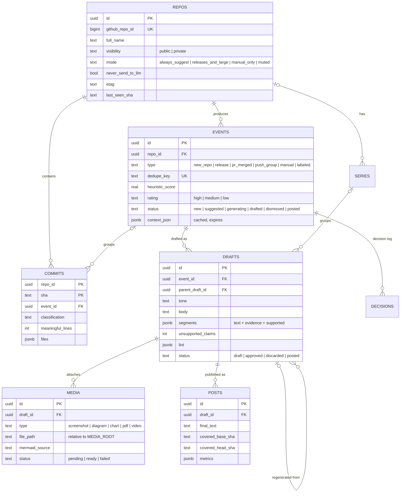

Standalone tables: **`settings`** (a single row: tone, voice, ban list, privacy mode, goals), **`connections`** (the encrypted GitHub token), **`sessions`** (SHA-256 hashes of session tokens), and **`jobs`** (the queue). Every enum has a matching `CHECK` constraint in the database, and every list endpoint uses keyset pagination over an index.

### Security model

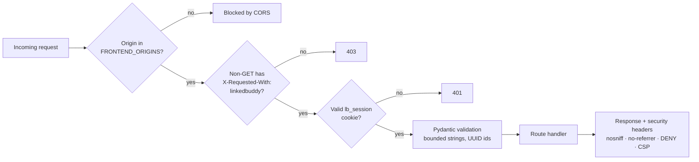

| Layer | Protection |
|---|---|
| **Network** | Binds to `127.0.0.1` only. Public binding needs `ALLOW_PUBLIC_BIND=true` **and** `APP_ENV=prod`. |
| **Login** | One argon2id-hashed owner password, a constant-time check, and a limit of 5 failures per IP per 15 minutes |
| **Sessions** | A 32-byte random token. Only its SHA-256 hash is stored. The cookie is `HttpOnly` and `SameSite=Strict`, and `Secure` in prod. Sessions last 14 days. |
| **Route guard** | A router-level `require_owner` dependency. A test fails the build if any route other than login and health lacks it. |
| **Secrets** | Kept in `.env` (git-ignored). The GitHub token is Fernet-encrypted in the database and never returned to the browser. |
| **GitHub** | A fine-grained read-only token. A test asserts that the client only ever issues `GET` requests. |
| **Outbound HTTP** | The shared `httpx` client refuses any host outside an allowlist (GitHub, Gemini, LinkedIn). |
| **Uploads** | Verified by decoding with Pillow, limited to PNG, JPEG and WebP, at most 10 MB and 8000×8000 px, re-encoded, saved under server-generated names, and served only through an authenticated endpoint |
| **Subprocesses** | Argument lists only (no shell), timeouts, a minimal environment, and the Chromium sandbox always on. Mermaid can't fetch URLs because all of its traffic goes to a closed proxy. |
| **LLM** | Repo text is untrusted data. The model has no tools, its output is schema-validated and rendered as text (never HTML), and inputs are redacted first. |
| **Logs** | Metadata only: IDs, counts, durations and status codes. Never tokens, prompts, post text or model output. |
| **Supply chain** | Dependencies are pinned in `uv.lock`, and `pip-audit` and `bandit` run as part of `make check`. |

The full rules are in [SECURITY.md](docs/rules/SECURITY.md).

### Performance design

The database is remote (Supabase), so every query costs a network round trip of about 20–150 ms. The backend aims for **fewer round trips** rather than micro-optimisations:

| Endpoint | Budget |
|---|---|
| `GET /api/inbox` | **1** query |
| Draft detail | **≤ 2** queries |
| Enqueue a job | **1** statement |
| `GET /api/jobs/{id}` | **1** primary-key lookup (polled every second) |

These budgets are asserted in tests with a fixture that counts statements. Every response carries a `Server-Timing: app;dur=…, db;dur=…` header, so you can see how much of each request went to the network. Other choices that keep things fast:

- **The event loop never blocks.** CPU-heavy work goes to `asyncio.to_thread`, and subprocesses use `asyncio.create_subprocess_exec`.
- **Clients are created once at startup:** the DB engine, `httpx` and Gemini.
- **No N+1 queries.** Relationships default to `lazy="raise"`, so an accidental lazy load fails in tests.
- **Ingestion writes in bulk:** all of a poll's commits are upserted in one statement.
- **Gemini calls are rate-limited client-side** with a token bucket per model tier, so the app stays under the free-tier RPM.
- **Dev mode logs slow queries**, any statement over `SLOW_QUERY_MS`.

---

## Tech stack

| Layer | Tech |
|---|---|
| **Backend** | Python 3.12 · FastAPI · uvicorn (uvloop, httptools) · Pydantic v2 · pydantic-settings · [uv](https://docs.astral.sh/uv/) |
| **Database** | PostgreSQL on [Supabase](https://supabase.com) (free tier, session pooler) · SQLAlchemy 2.0 async · asyncpg · Alembic |
| **Job queue** | Postgres (`SKIP LOCKED` + `LISTEN/NOTIFY`), no broker |
| **AI** | Google Gemini API free tier via `google-genai` · `gemini-flash-lite-latest` (rating) · `gemini-flash-latest` (drafts) |
| **HTTP** | One shared `httpx.AsyncClient` with a host allowlist |
| **Security** | argon2-cffi · cryptography (Fernet) |
| **Media** | Pillow · `@mermaid-js/mermaid-cli` (Puppeteer + Chromium) · `brag` (optional video) |
| **Frontend** | React 19 · TypeScript · Vite · Tailwind CSS 4 · shadcn/ui (Radix) · TanStack Query · React Router |
| **Motion** | Motion · GSAP + ScrollTrigger · Lenis · React Three Fiber / drei |
| **Quality** | ruff · mypy `--strict` · bandit · pip-audit · pytest + pytest-asyncio + respx · oxlint |

---

## Getting started

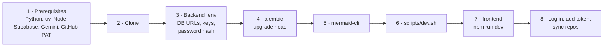

### 1. Prerequisites

| You need | Notes |
|---|---|
| **Python 3.12** + **[uv](https://docs.astral.sh/uv/getting-started/installation/)** | `uv` manages the virtualenv and lockfile |
| **Node.js 20+** + npm | For the frontend and the Mermaid renderer |
| **Two [Supabase](https://supabase.com) projects** (free) | One for the app, one for tests. The tests write real rows, so keep them apart. |
| **A [Gemini API key](https://aistudio.google.com/apikey)** | Free tier is enough |
| **A GitHub fine-grained PAT** | Read-only, limited to the repos you want watched: *Contents: Read*, *Metadata: Read*, *Pull requests: Read* |

### 2. Clone

```bash
git clone https://github.com/iloveass7/LinkedBuddy.git
cd LinkedBuddy
```

### 3. Configure the backend

```bash
cp .env.example .env
cd backend
uv sync
```

Generate the encryption key, which encrypts the GitHub token at rest:

```bash
uv run python -c "from cryptography.fernet import Fernet; print(Fernet.generate_key().decode())"
```

Hash your login password. It prompts without echoing your input:

```bash
uv run python scripts/hash_password.py
```

Then edit `.env` at the repo root:

| Variable | Value |
|---|---|
| `DATABASE_URL` | In Supabase, go to **Connect → Session pooler** and copy the URI (port **5432**). Change `postgresql://` to `postgresql+asyncpg://`. |
| `TEST_DATABASE_URL` | Same format, from your **second** Supabase project |
| `APP_ENCRYPTION_KEY` | The Fernet key you just generated |
| `OWNER_PASSWORD_HASH` | The argon2 hash you just generated |
| `GEMINI_API_KEY` | Your Gemini key |
| `GITHUB_TOKEN` | **Leave it unset.** You'll paste the token into Settings, where it's stored encrypted. |

> A connection string looks like `postgresql+asyncpg://postgres.<ref>:<password>@aws-0-<region>.pooler.supabase.com:5432/postgres`. Pick the Supabase region closest to you, because every query is a network round trip.

### 4. Create the schema

```bash
uv run alembic upgrade head
```

### 5. Install the diagram renderer

```bash
npm install --prefix tools @mermaid-js/mermaid-cli
```

If you already have Chromium (Playwright's, for example), skip Puppeteer's ~150 MB download:

```bash
PUPPETEER_SKIP_DOWNLOAD=1 npm install --prefix tools @mermaid-js/mermaid-cli
echo '{"executablePath": "/path/to/chrome"}' > tools/puppeteer-config.json
```

### 6. Start the backend

```bash
scripts/dev.sh
```

When it's up, you should see:

- `Uvicorn running on http://127.0.0.1:8000`
- two `worker kinds=…` lines
- a scheduler `tick {…}` line every minute

The interactive API docs are at **http://127.0.0.1:8000/docs** (dev mode only).

### 7. Start the frontend

In a second terminal, from the repo root:

```bash
cd frontend
cp .env.example .env
npm install
npm run dev
```

Open **http://localhost:5173**.

> ⚠️ Use `localhost`, **not** `127.0.0.1`. The session cookie is `SameSite=Strict`, and the backend's CORS only allows `http://localhost:5173`.

### 8. First run

1. **Log in** with the password you hashed.
2. **Settings → Connections:** paste your GitHub PAT, then **Sync repos**.
3. **Settings → Repos:** set each repo's mode. Private repos start with AI turned off, and turning it on asks you to acknowledge the free-tier data terms.
4. **Settings → Voice:** set your goals, default tone, length, voice samples and ban list.
5. Wait for the first scheduled poll (up to a minute), or trigger one for a repo.
6. Open the **Inbox**. Events appear and their ratings fill in as `rate_event` jobs finish.
7. Pick an event and click **Generate**. The drafts and diagram appear in the **Review** studio.
8. Edit, approve, **Copy draft**, paste it into LinkedIn, then record the post so the event moves to the archive.

### Optional: video

Video stays off until you point LinkedBuddy at a `brag` command:

```env
BRAG_COMMAND=["brag"]
VIDEO_TIMEOUT_S=600
```

---

## Configuration reference

All backend settings are read once, through `backend/src/linkedbuddy/config.py`. Values come from the repo-root `.env`, and `backend/.env` overrides them if it exists.

<details>
<summary><b>Backend variables</b></summary>

| Variable | Default | Purpose |
|---|---|---|
| `APP_ENV` | `dev` | `dev` turns on `/docs` and non-Secure cookies. `prod` adds HSTS and Secure cookies. |
| `DATABASE_URL` | none (required) | App database (asyncpg, session pooler) |
| `TEST_DATABASE_URL` | none | Test database. Must be a different project. |
| `APP_ENCRYPTION_KEY` | none (required) | Fernet key for tokens stored in the database |
| `OWNER_PASSWORD_HASH` | none (required) | argon2id hash of the login password |
| `GITHUB_TOKEN` | none | Fallback token. Prefer storing it through Settings. |
| `GEMINI_API_KEY` | none | Without it, ratings show "AI not configured" |
| `GEMINI_MODEL_FAST` | `gemini-flash-lite-latest` | Model for rating |
| `GEMINI_MODEL_QUALITY` | `gemini-flash-latest` | Model for drafts, quick edits and video scripts |
| `GEMINI_RPM_FAST` / `GEMINI_RPM_QUALITY` | `10` / `5` | Client-side requests-per-minute limits |
| `FRONTEND_ORIGINS` | `["http://localhost:5173"]` | CORS allowlist. Exact origins only, no `*`. |
| `MEDIA_ROOT` | `var/media` | Where rendered and uploaded media is stored (relative to `backend/`) |
| `MMDC_PATH` | `tools/node_modules/.bin/mmdc` | Mermaid CLI. Falls back to `mmdc` on `PATH`. |
| `MMDC_PUPPETEER_CONFIG` | `tools/puppeteer-config.json` if it exists | Supplies Chromium's `executablePath` |
| `POLL_INTERVAL_MINUTES` | `180` | How often each repo is polled |
| `BRAG_COMMAND` | unset (video off) | JSON list, e.g. `["brag"]` |
| `VIDEO_TIMEOUT_S` | `600` | Video render timeout |
| `ALLOW_PUBLIC_BIND` | `false` | Allows a non-loopback bind (also needs `APP_ENV=prod`) |
| `SLOW_QUERY_MS` | `100` | Dev-only threshold for the slow-query log |
| `HOST` / `PORT` | `127.0.0.1` / `8000` | Read by `scripts/dev.sh` |

</details>

<details>
<summary><b>Frontend variables</b></summary>

| Variable | Example | Purpose |
|---|---|---|
| `VITE_API_BASE_URL` | `http://localhost:8000/api` | Backend base URL. Everything prefixed `VITE_` ends up in the browser bundle, so never put secrets there. |

</details>

<details>
<summary><b>Settings you change in the app</b></summary>

| Setting | Options |
|---|---|
| Default tone | professional · casual · technical · storytelling |
| Post length | short · medium · long |
| Emoji policy | none · light (≤ 2) · any |
| Hashtags | 0–5 |
| Privacy mode | full · metadata_plus_readme (default) · metadata_only · never_send |
| Goals | Free text that steers the rating ("I'm looking for backend roles") |
| Custom instructions | Up to 500 characters |
| Voice samples | Up to 5 past posts, each up to 5,000 characters |
| Ban list | Up to 100 phrases |
| Per repo | mode · never-send-to-AI · demo URL |

</details>

---

## API reference

Everything is under `/api`. Every route needs a session except `POST /api/auth/login` and `GET /api/health`, and every non-GET request needs the `X-Requested-With: linkedbuddy` header.

<details>
<summary><b>All endpoints</b></summary>

| Method | Path | Description |
|---|---|---|
| `GET` | `/health` | DB check and queue depth per job kind |
| `POST` | `/auth/login` | Log in with `{password}` and receive a cookie |
| `POST` | `/auth/logout` | Delete the session |
| `GET` | `/auth/me` | Session info |
| `PUT` | `/connections/github` | Store the GitHub PAT (encrypted) |
| `POST` | `/repos/sync` | Import repos from GitHub |
| `GET` | `/repos` | List repos |
| `PATCH` | `/repos/{id}` | Change mode, AI opt-in, demo URL |
| `POST` | `/repos/{id}/poll` | Poll now (returns 202 + job) |
| `POST` | `/repos/{id}/events` | Create a manual event |
| `GET` | `/repos/{id}/posts` | Posts published for a repo |
| `GET` | `/inbox` | Rated events (keyset-paginated) |
| `POST` | `/events/{id}/dismiss` | Dismiss an event |
| `POST` | `/events/{id}/generate` | Generate drafts (returns 202 + job) |
| `GET` | `/events/{id}/drafts` | Drafts for an event |
| `GET` | `/drafts/{id}` | One draft |
| `PATCH` | `/drafts/{id}` | Edit the body, approve, discard |
| `POST` | `/drafts/{id}/regenerate` | Regenerate with a tone (returns 202 + job) |
| `POST` | `/drafts/{id}/quick-edit` | Inline AI edit (30 s timeout). Returns a new child draft. |
| `POST` | `/drafts/{id}/media` | Upload a screenshot |
| `PATCH` | `/media/{id}` | Reorder, include or exclude, alt text |
| `PUT` | `/media/{id}/mermaid` | Edit diagram source and re-render (returns 202 + job) |
| `GET` | `/media/{id}/file` | Serve a media file (authenticated) |
| `POST` | `/drafts/{id}/video` | Render a video (returns 202 + job) |
| `POST` | `/drafts/{id}/publish` | Record a publish with the final text |
| `PATCH` | `/posts/{id}/metrics` | Log post metrics |
| `GET` | `/jobs/{id}` | Job status (poll this) |
| `GET` / `PUT` | `/settings` | Read or update owner settings |

</details>

<details>
<summary><b>Driving it with curl</b></summary>

```bash
H='X-Requested-With: linkedbuddy'
curl -c jar -H "$H" -H 'Content-Type: application/json' \
  -d '{"password": "..."}' http://127.0.0.1:8000/api/auth/login
curl -b jar -X PUT -H "$H" -H 'Content-Type: application/json' \
  -d '{"token": "github_pat_..."}' http://127.0.0.1:8000/api/connections/github
curl -b jar -X POST -H "$H" http://127.0.0.1:8000/api/repos/sync
curl -b jar http://127.0.0.1:8000/api/inbox
```

The full walkthrough is in [`backend/README.md`](backend/README.md#first-real-run).

</details>

---

## Development and testing

```bash
cd backend
make check                  # ruff, ruff format --check, mypy --strict, bandit, pip-audit, all tests
make test                   # tests only, run in 5 chunks
uv run pytest tests/drafts  # one area while iterating
```

```bash
cd frontend
npm run build   # tsc -b + vite build
npm run lint    # oxlint
```

**About the tests:**

- About **380 tests** across 33 files.
- **Pure logic** (classification, scoring, validation, lint, redaction) is unit-tested with no database.
- **Tests never call the real GitHub, Gemini or LinkedIn.** HTTP is mocked with `respx`, and Gemini is replaced by a `FakeLLM` behind the `LLMProvider` protocol.
- **Round-trip budgets** are asserted with a fixture that counts SQL statements.
- **A security test** walks every route and fails if any route other than login and health lacks auth.
- **`tests/test_e2e.py`** runs the whole pipeline (sync → poll → rate → generate → render → approve → publish) against the test database, then cleans up its rows.
- Against a remote test database the full suite takes over 10 minutes, which is why `make test` runs it in chunks.

**Contributor rules:** the binding rules for any backend change are in [`docs/rules/`](docs/rules). Each file ends with a PR checklist:

- [ARCHITECTURE.md](docs/rules/ARCHITECTURE.md): stack, process layout, pipeline, budgets, external-call rules
- [DATABASE.md](docs/rules/DATABASE.md): schema, migrations, indexes, the queue, retention
- [SECURITY.md](docs/rules/SECURITY.md): secrets, auth, validation, uploads, LLM safety

The original product spec is [`github-linkedin-post-app-pitch.md`](github-linkedin-post-app-pitch.md).

---

## Project layout

```
LinkedBuddy/
├── backend/
│   ├── src/linkedbuddy/
│   │   ├── main.py          # app factory + lifespan (engine, httpx, Gemini created once)
│   │   ├── config.py        # the only place env is read
│   │   ├── serve.py         # uvicorn entry point with the bind gate
│   │   ├── worker.py        # worker entry point
│   │   ├── scheduler.py     # 60 s tick: polls, stale locks, retention
│   │   ├── auth/            # login / logout / me
│   │   ├── db/              # async engine, ORM models
│   │   ├── github/          # client (ETag, pagination), classify (pure), ingest
│   │   ├── triage/          # score (pure heuristic), rate (LLM judge job)
│   │   ├── llm/             # LLMProvider protocol, Gemini, token bucket, FakeLLM
│   │   ├── drafts/          # context package, prompts, generate, validate, lint
│   │   ├── media/           # storage, image re-encoding, Mermaid rendering
│   │   ├── video/           # VideoRenderer protocol, brag adapter, video job
│   │   ├── jobs/            # Postgres queue, worker loop, handler registry
│   │   ├── security/        # sessions, Fernet, redaction, middleware
│   │   └── inbox/ repos/ posts/ settings/   # thin routers + services
│   ├── migrations/          # Alembic
│   ├── scripts/             # dev.sh, hash_password.py
│   ├── tools/               # local mermaid-cli install
│   └── tests/               # pytest, mirrors src/
├── frontend/
│   └── src/
│       ├── app/router.tsx   # lazy-loaded routes
│       ├── lib/api.ts       # the only module that calls the backend
│       ├── pages/           # Landing, Login, Inbox, Review, Archive, Settings
│       ├── components/      # app shell, review studio, landing sections, ui/
│       └── hooks/useJob.ts  # polls job status
├── docs/rules/              # binding architecture, database and security rules
└── .env.example
```

---

## Troubleshooting

| Symptom | Cause and fix |
|---|---|
| Every `POST` returns **403** | The `X-Requested-With: linkedbuddy` header is missing. The frontend's `api.ts` adds it, but curl needs it added by hand. |
| You log in but get bounced back to `/login` | You opened `127.0.0.1:5173`. Use **`localhost:5173`**, because the cookie is `SameSite=Strict`. |
| CORS errors in the browser console | The frontend's origin isn't in `FRONTEND_ORIGINS`. |
| Login returns **429** | 5 failed attempts in 15 minutes. Wait it out. |
| `HOST=0.0.0.0` refuses to start | This is intentional. See [Deploying beyond localhost](#deploying-beyond-localhost). |
| Rating says **"Not sent to AI (privacy)"** | The repo is private (AI is off by default), privacy mode is `never_send`, or a secret was found in a private repo. |
| Rating says **"AI not configured"** | `GEMINI_API_KEY` isn't set. |
| Jobs sit `queued` for a while | Gemini free-tier rate limit. They're deferred with backoff and retry on their own. |
| Diagram shows **failed** | Chromium couldn't start with its sandbox on. On Linux, unprivileged user namespaces may need to be enabled, or point `puppeteer-config.json` at a working Chrome. Everything else keeps working. |
| Database connection errors | Use the Supabase **session pooler** URI on port **5432**, with the `postgresql+asyncpg://` scheme. |
| Noisy `slow query` logs | Remote round trips alone are 100–400 ms. Raise `SLOW_QUERY_MS`. |
| Processes left running after Ctrl-C | Check with `pgrep -fa linkedbuddy`. `dev.sh` stops them all when any one exits. |

---

## Deploying beyond localhost

LinkedBuddy is built for one person on one machine. To expose it anyway, you need **all** of these:

1. `ALLOW_PUBLIC_BIND=true` **and** `APP_ENV=prod`. This turns off `/docs`, sets `Secure` cookies and sends HSTS.
2. **HTTPS in front**, from a reverse proxy such as Caddy or nginx.
3. `FRONTEND_ORIGINS` set to your real frontend origin.
4. A built frontend (`npm run build`) served from that origin, with `VITE_API_BASE_URL` pointing at the API.

Read [SECURITY.md §2](docs/rules/SECURITY.md) first.

---

## Roadmap

- [x] GitHub ingestion with ETags, classification and event grouping
- [x] Two-stage triage (free heuristic + LLM judge) and the rated inbox
- [x] Evidence-grounded drafts, the anti-slop linter, regeneration and quick edits
- [x] Mermaid diagrams, screenshot uploads, optional video
- [x] The web studio: landing, inbox, review, archive, settings
- [ ] One-click publishing through the LinkedIn API (copy and paste for now)
- [ ] Charts built from real numbers in the repo
- [ ] PDF carousel export
- [ ] Series planner for multi-post project arcs
- [ ] Weekly roundup drafts and gentle reminders to keep posting
